# D&D 5E Toolkit for M5Stack Cardputer ADV

Firmware with game-master and player tools for D&D 5e (SRD 5.2.1 / 2024 rules).

A port to the M5Stack Tab5 is planned: see [docs/TAB5_PORT.md](docs/TAB5_PORT.md).

Development notes (tools, data pipeline, testing): [docs/DEVELOPMENT.md](docs/DEVELOPMENT.md).

## Screenshots

| | |
|---|---|
| 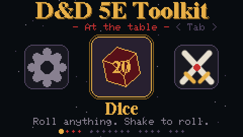 | 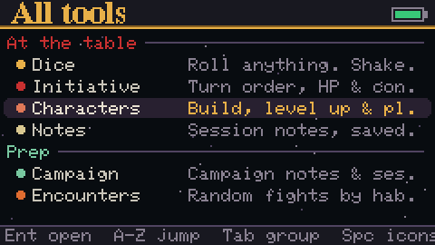 |
| 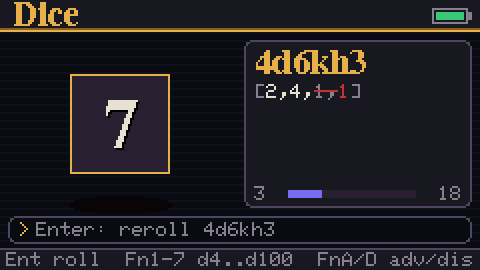 | 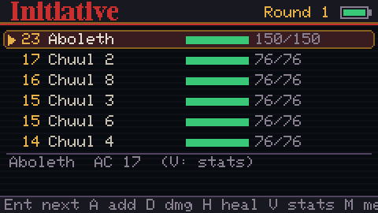 |
| 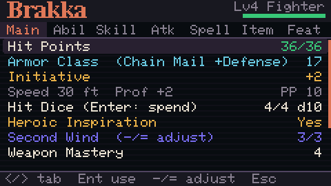 | 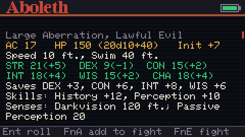 |
| 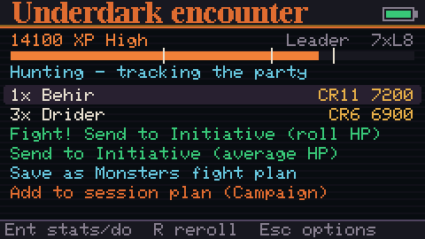 | 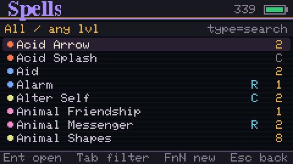 |
| 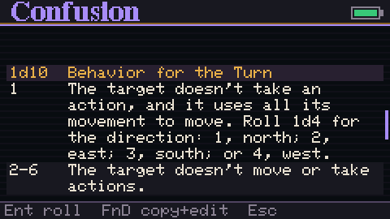 | 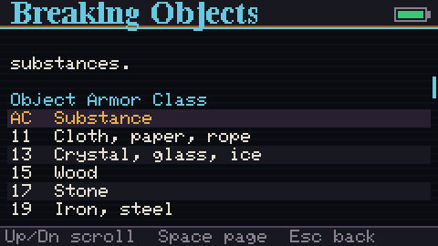 |

The web interface, from a laptop or phone:

| | |
|---|---|
| 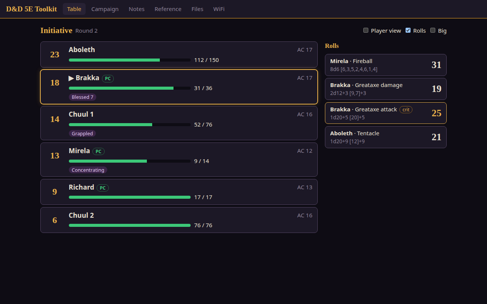 | 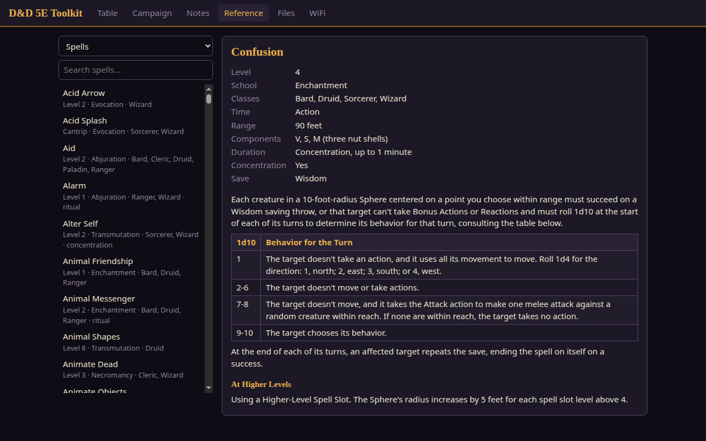 |
| 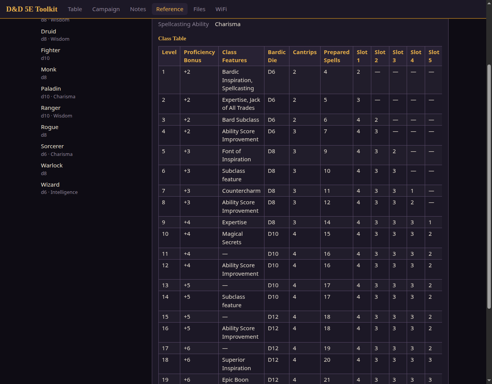 | 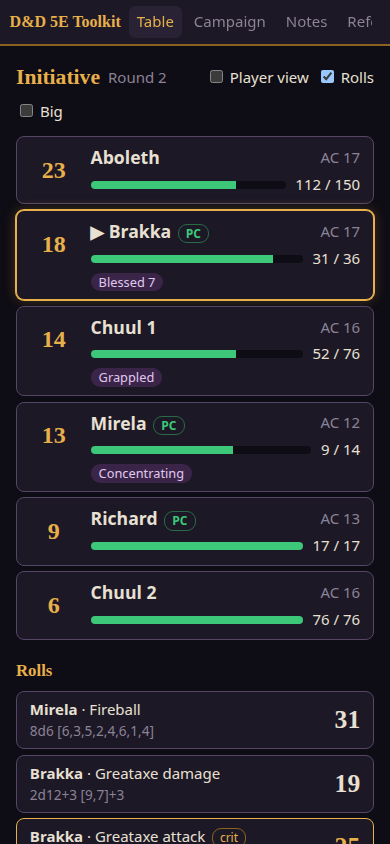 |

## Build and flash

```sh
~/.platformio/penv/bin/pio run -t upload
```
`platformio.ini` finds this Cardputer by its USB serial number (`/dev/serial/by-id/...`). Change `upload_port` there to flash a different unit.

The default environment, `cardputer-adv`, uses Arduino core 3.x (the pioarduino platform, the same toolchain the Tab5 needs). `cardputer-adv-legacy` builds the same code with the older core 2.0.14: `pio run -e cardputer-adv-legacy -t upload`. Device-specific code (start-up, keyboard, SD pins) is in `src/board/`.

## Controls

| Key | Action |
|---|---|
| `;` `.` `,` `/` | Up, down, left, right (arrow keys). In text screens, hold **Fn** for arrows. |
| `` ` `` | Back / Esc |
| Enter | OK |
| 1-9, 0 on the home screen | Open the 1st-10th app (Dice, Initiative, Characters, Notes, Campaign, Encounters, Monsters, Dungeon, Random Tables, Travel) |

### Home screen
Apps are grouped: **At the table** (Dice, Initiative, Characters, Notes), **Prep** (Campaign, Encounters, Monsters, Dungeon, Random Tables, Travel, Magic Shop), **Reference** (Spells, Items, Rules, Hazards) and **System** (Archive, Web, Settings).
- **Tab** / **Shift+Tab** jump to the next / previous group.
- **Letters** jump to the next app starting with that letter (C: Characters, Campaign).
- **Space** switches between the icon carousel and a list of every app with its description (remembered).
- The home screen starts on the last app you opened.

### Dice
- Type an expression and press Enter. Enter on an empty line rerolls the last roll. **Shake the device** to roll.
- `d20+5`, `4d6kh3` (keep highest 3), `2d20kl1` (keep lowest), `adv+7`, `dis`, `8d6`, `d%`, `3d6!` (exploding), `2d6r1` (reroll 1s once)
- `d20+7 vs 15` checks against a DC. A lone d20 showing a natural 20 is a crit and a natural 1 is a fumble.
- **Fn+1..7**: d4, d6, d8, d10, d12, d20, d100. **Fn+A / Fn+D**: advantage or disadvantage, adding any `+5` already typed.
- **Fn+M**: saved rolls. **Fn+H**: history. **Fn+;** and **Fn+.**: recall earlier expressions.

### Characters
- **+ New character** starts a creation wizard in the 2024 order:
  - class, background, species, and species options (ancestry, lineage, Keen Senses, Human Skillful/Versatile)
  - ability scores: standard array, point buy, 4d6 drop lowest, or manual entry
  - background bonuses (+2/+1 or +1/+1/+1) and class skills
  - class choices: Rogue Expertise, Fighter Fighting Style, Cleric Divine Order, Druid Primal Order
  - cantrips and prepared spells, Magic Initiate picks, starting equipment, alignment

  Every step shows the SRD details for the highlighted option.
- The sheet has tabs, switched with **< >**; **Enter** rolls or uses the selected line:
  - **Main**: HP (enter `7` damage, `+5` heal, `t4` temp, or dice), AC (armor, shield, Unarmored Defense, magic), initiative, hit dice, death saves, Heroic Inspiration, class resources (Rages, Second Wind, Focus Points... adjusted with `-`/`=`), short rest, long rest, **level up**
  - **Abil**: Enter rolls a check, **S** rolls a save
  - **Skill**: Enter rolls; **P** and **E** toggle proficiency and expertise
  - **Atk**: weapon attacks with to-hit and damage (Finesse, Versatile, Monk martial arts, proficiency), Unarmed Strike, Dragonborn breath. A natural 20 doubles the damage dice.
  - **Spell**: save DC and attack bonus, slots (`-`/`=`), and casting. Leveled spells pick a slot with **< >**, use it, and roll upcast damage or healing. **Fn+A** learns a spell from the library; **X X** forgets one.
  - **Item**: coins (`+10 gp`, `-3 sp`) and inventory. Enter opens actions: roll, drink (heals you), equip, attune (max 3), charges, quantity, rename, remove. **Fn+A** adds from the Item Database.
  - **Feat**: class and subclass features up to your level, species traits and feats. Enter reads the SRD text.
- **Level up**: HP (average or roll), new features, subclass at level 3, Ability Score Improvement or a feat, Epic Boon at 19, new cantrips and prepared spells. Slots and resources update automatically.
- Characters are stored as readable text in `/gmtools/characters/`.
- Not yet supported: multiclassing. Weapon Mastery and most feature effects are shown as text rather than applied automatically.

### Spells
All 338 SRD spells plus your own. Type to search, **Tab** cycles the class filter, digits **0-9** filter by level. Spells are marked C for concentration and R for ritual.
In a spell's detail view, **Enter** rolls its attack and damage or healing, and **< >** changes the slot level (or the character level, for cantrips).
**Fn+N** opens the spell wizard: level, school, class lists, casting time, ritual, range, components, duration, concentration, attack/save/healing, dice, upcast dice and description. Custom spells can be edited (**Fn+E**) or deleted (**Fn+X X**). **Fn+D** copies an SRD spell into an editable custom one. Custom spells are saved to `/gmtools/custom/spells.txt`.

### Items
SRD weapons, armor, gear, tools and 271 magic items, plus your own. **Tab** filters by type.
**Fn+N** opens the item wizard. Its questions depend on the type:
- weapon: category, damage, properties, versatile dice, range, mastery
- armor: category, base AC, Strength requirement, stealth
- shield: AC bonus
- consumable or magic item: what it rolls, charges, rarity, attunement
- tool: ability and use

Custom items are saved to `/gmtools/custom/items.txt`.

### Monsters
330 SRD stat blocks. Type to search, **Tab** filters by creature type, and **0-9** filter by CR (0 = below 1).
A stat block shows AC, HP, speed, abilities, saves, senses, CR and XP, plus traits, actions, bonus actions, reactions and legendary actions. **Enter** opens a roll menu: each attack (to-hit plus damage), save effects (DC plus damage), initiative, rolled HP and saving throws.
**Fn+A** adds the monster to the current fight. **Fn+E** opens the **encounter builder**:
- set party size and level
- adjust monster counts with `-`/`=`
- a live difficulty meter compares the fight's XP with the SRD budgets (Low / Moderate / High)
- **Send to Initiative** with rolled or average HP; each monster rolls initiative and brings its AC, and the Initiative tracker opens

### Encounters
Random encounter generator. Pick **party size**, **party level**, **habitat** (Arctic, Coastal, Desert, Dungeon, Forest, Grassland, Hill, Mountain, Planar, Swamp, Underdark, Underwater, Urban or Any), **difficulty** (Low / Moderate / High), **creature type** and **group** style:
- **Solo**: one big creature worth half to all of the XP budget
- **Leader + minions**: a boss plus weaker creatures, preferring the boss's type
- **Horde**: many of one creature
- **Mixed**: up to three kinds
- **Random**: picks one of the above

The result shows the creatures, their total XP on the difficulty meter, and what they're doing when found. **Enter** on a creature opens its stat block, **R** rerolls, and **Send to Initiative** (rolled or average HP) adds the fight and opens the tracker. **Save as Monsters fight plan** copies it into the Monsters encounter builder for tweaking. If nothing fits the habitat or type, the generator widens the search and says so.

The SRD has no habitats, so `tools/srd_habitats.py` assigns them (based on the Monster Manual); the extractor writes them into `monsters.idx`. Custom monsters match every habitat.

### Rules
The SRD Rules Glossary (155 entries): conditions, actions, areas of effect, hazards, attitudes and general rules. **Tab** filters by type.

### Hazards
The Gameplay Toolbox's traps, poisons (with prices), magical contagions and environmental hazards. Each shows its save DC, damage and how to spot it; **Enter** rolls the damage.

### Travel
Pick the terrain, road, pace, hours per day, distance and party size. It shows:
- the pace the terrain allows (good roads raise it one step)
- miles per hour and per day, and days for the trip
- the pace's effect on checks
- forced-march Constitution save DCs
- food and water needed

**Enter** rolls the terrain's encounter distance, navigation and foraging checks.

### Magic Shop
**Tab** switches calculators:
- **Magic item price:** value by rarity, plus crafting time and cost (halved for consumables)
- **Spell scroll:** scribing time and cost, the scroll's value, and the cost of hiring a caster
- **Nonmagical craft:** materials cost and crafting days
- **Random shop:** stock for a village, town or city, drawn from SRD magic items with asking prices

### Initiative
- **A** adds a combatant: name, then initiative (`15`, `+3` to roll d20+3, or dice), then HP (`22`, `4d8+4`, or blank for a PC).
- **Enter/Space** moves to the next turn. Conditions count down at the end of their owner's turn; 0 means they last until removed.
- **D** damage, **H** heal (both accept dice), **C** condition, **I** change initiative (re-sorts), **U** duplicate (Goblin -> Goblin 2), **X X** remove, **N N** clear the encounter.
- **M** (or Tab) opens the actions menu: set initiative, rename, set max HP, duplicate, conditions, remove, **restart at round 1**, **remove monsters but keep PCs**, and **clear encounter**. Destructive actions need Enter twice.
- The encounter autosaves to the SD card a moment after each change and is reloaded at boot.
- Monsters sent from the encounter builder arrive with HP and AC; **V** shows the selected monster's stat block.
- **M → Add party** adds your saved characters with rolled initiative, current HP and AC.
- In the condition picker (**C**), **→** shows the SRD rule text for the highlighted condition.

### 5-Room Dungeon
Follows the [5 Room Dungeon](https://www.roleplayingtips.com/5-room-dungeons/) structure: Entrance & Guardian, Puzzle/Roleplay, Trick/Setback, Climax, Reward & Revelation. 
**< >** moves between rooms, **Enter** makes a new dungeon, and **R** rerolls the current page.
**S** saves the dungeon to `/gmtools/dungeons/The_Dungeon_Name.txt`. Saving again after rerolling overwrites the same file. **L** lists saved dungeons: Enter loads one back, map included; **X X** deletes it. Saved dungeons can also be read in Archive.

### Random Tables
SRD tables, marked "SRD":
- Trinkets (d100) and Wand of Wonder effects
- Mysterious Deck draws, with each card's effect
- the three Bags of Tricks
- sentient item alignment, communication, senses and purpose
- standard and rare languages
- fear and mental stress effects, traps, poisons, contagions and environmental hazards
- magic items by rarity, with typical prices

Homemade tables: NPCs, taverns, locations, strong starts, weather, rumors, and **loot by tier** (1–4), which draws real SRD magic items and trinkets.
Each result shows the die roll, for example "d100: 47". Long results scroll with Up/Down. Any `.txt` file in `/gmtools/tables/` becomes a table, and a file with the same name as a built-in or SRD table replaces it. One entry per line; `{Other table}` nests a roll, `[2d6]` rolls dice, and a leading `20<TAB>` weights an entry (for d100 ranges).

### Campaign
Campaign and session planner. Each campaign has **campaign notes** (pitch & notes, threads & quests, NPCs, locations, factions, party) and numbered **session plans** laid out like the "Lazy DM" prep checklist: recap, spotlight, strong start, scenes, secrets & clues, locations, NPCs, encounters, treasure and notes.

- **Campaign list:** **N** new campaign, **Fn+X** twice deletes a campaign and its sessions.
- **Campaign screen:** campaign notes, then sessions (newest first). **N** new session, **T** renames the campaign, **Fn+X** twice deletes a session.
- **New sessions** carry over every unrevealed secret & clue from the last session, and copy its notes into the recap.
- **Planning screen:** sections fold with **Enter**; **</>** jump between sections. On an item: **Enter** edits, **Space** ticks it (revealed, run, given...), **A** adds, **X X** deletes, **-/=** move it. **T** renames the plan, **P** marks a session played. The selected item's full text shows at the bottom.
- **G** rolls something into the section: NPCs, locations and strong starts from Random Tables, rumors for secrets and threads, loot for treasure (tier from the party level in Monsters/Encounters), and your saved characters for party/spotlight. On Encounters it opens the Encounters app; pick **Add to session plan** there.
- **R** on an encounter line runs it: "3x Goblin Warrior, Goblin Boss" (also "3 goblin warriors and a goblin boss"; text in parentheses is ignored) goes straight into Initiative with HP rolled, and the item is ticked.
- Files are plain text in `/gmtools/campaigns/<name>/` (`campaign.txt`, `session_001.txt`, ...), easy to edit on a PC: `## Section` headings and `[ ]` / `[x]` items.

Text prompts now have a cursor: **Fn+</>** move it (Fn+Up/Down by a line), Del erases before it.

### Notes
- **Enter** on "+ New note" (or **N**) starts a note; the first line becomes its title.
- Type normally. **Enter** starts a new line, and **Fn + ; . , /** move the cursor.
- **Fn+T** inserts the session time, like `[1:05]`. **Fn+S** saves.
- **Esc** saves and closes. Notes also autosave 4 s after you stop typing.
- Saved as `/gmtools/notes/noteNNN.txt`. Without an SD card, notes are kept only until power off.

### Archive
Everything you've saved on the card: your own pages (`.txt` files in `/gmtools/ref/`, where `# ` lines are headings and `- ` lines are bullets), saved 5-Room Dungeons, and roll logs. **Enter** opens a file, **Fn+X** twice deletes it, and **Delete all roll logs** clears every log. Rules text lives in the **Rules** app.

### Web
Use the toolkit from a phone, tablet or laptop over WiFi. **Enter** starts web access. It joins your home network if you've saved one (**W**, or the WiFi tab in the browser); otherwise, or if joining fails, it makes its own hotspot. The screen shows the network, its password, the address (`http://dnd.local` also works on a home network) and a QR code: in hotspot mode the QR joins the network, and **Q** switches it to the address. The browser asks for the 4-digit PIN shown on the screen, which is new each time web access starts.

Once started it keeps running while you use other apps, and a WiFi mark shows in the title bar. It stops when you press **Enter** in Web again or power off. It never starts on its own. In the browser:

- **Table** shows initiative and the latest rolls live. Rolls come from Dice and from any roll popup. **Player view** hides monster HP and AC, and **Big** enlarges everything for a TV.
- **Campaign** edits campaigns and sessions. New sessions carry over secrets and the recap, the same as on the Cardputer.
- **Notes** edits notes, **Reference** searches the SRD, and **Files** manages everything under `/gmtools` (upload, download, rename, delete, edit text files).

Edits save a moment after you stop typing. Don't edit the same campaign or note in the browser while it's open on the Cardputer: whichever saves last wins. The page lives in `web/index.html` and is built into the firmware (`tools/web_embed.py` runs on every build).

## SRD data

The license attribution below is also shown on the device in **Settings → About & license**.

The character, spell and item tools read data extracted from the SRD 5.2.1 PDF:

```sh
python3 -m venv tools/.venv && tools/.venv/bin/pip install pymupdf pyserial
tools/.venv/bin/python tools/srd_extract.py SRD_CC_v5.2.1.pdf sdcard/gmtools/srd
tools/.venv/bin/python tools/sdsync.py sdcard/gmtools/srd /gmtools/srd   # copy over USB
```

You can also copy `sdcard/gmtools/` onto the card with a card reader.

This work includes material from the System Reference Document 5.2.1 ("SRD 5.2.1") by Wizards of the Coast LLC, available at https://www.dndbeyond.com/srd. The SRD 5.2.1 is licensed under the Creative Commons Attribution 4.0 International License, available at https://creativecommons.org/licenses/by/4.0/legalcode.

## SD card

Format the card as **FAT32** (exFAT isn't supported). Cards of 32 GB or less are easiest. You can also format from **Settings → Format SD card**, which erases the card. Copy the `sdcard/gmtools` folder from this repo onto the card for examples.

```
/gmtools/macros.txt                    saved rolls, Name=expr
/gmtools/tables/*.txt                  random tables ({nested}, [2d6])
/gmtools/ref/*.txt                     your own pages, shown in Archive ("# heading", "- bullet")
/gmtools/conditions.txt                condition list for Initiative (replaces the built-in one)
/gmtools/dungeon/*.txt                 override 5-Room Dungeon tables
/gmtools/dungeons/                     saved dungeons
/gmtools/logs/sessionNNN.txt           roll log (one per boot)
/gmtools/notes/noteNNN.txt             notes
/gmtools/srd/*.txt, *.idx              SRD data (spells, items, magic, classes, features, species, feats,
                                       monsters, glossary, toolbox)
/gmtools/srd/tables/*.txt              SRD roll tables
/gmtools/encounter_plan.txt            the encounter builder's current fight
/gmtools/custom/spells.txt, items.txt  your spells and items
/gmtools/characters/*.txt              characters
/gmtools/encounter.txt                 current initiative state
/gmtools/crash.txt                     written if the hang watchdog ever fires
```
Everything works without a card. The card adds saving, logs and your own content.

## Debugging

Over USB serial at 115200 baud: `key <up|down|left|right|enter|back|del|tab|space|c|fn+c>`, `type <text>`, `shot` (dumps the screen as RGB565 hex), `mem`, `perf` (frame and key-handling times since the last `perf`), `ls [dir]`, `rm <path>`, `put <path>` (used by `tools/sdsync.py`), `shot <scale>` (compressed, optionally downscaled screenshot).
`tools/dev.py` drives the console from a PC: `tools/.venv/bin/python tools/dev.py "key 7|wait:1|type abol|key enter|shot:aboleth"` presses keys and saves `aboleth.png`.
A watchdog on core 0 reboots the device if the main loop stalls for 4 s. It prints `HANG at <app>:<step>` and records it in `/gmtools/crash.txt`.
